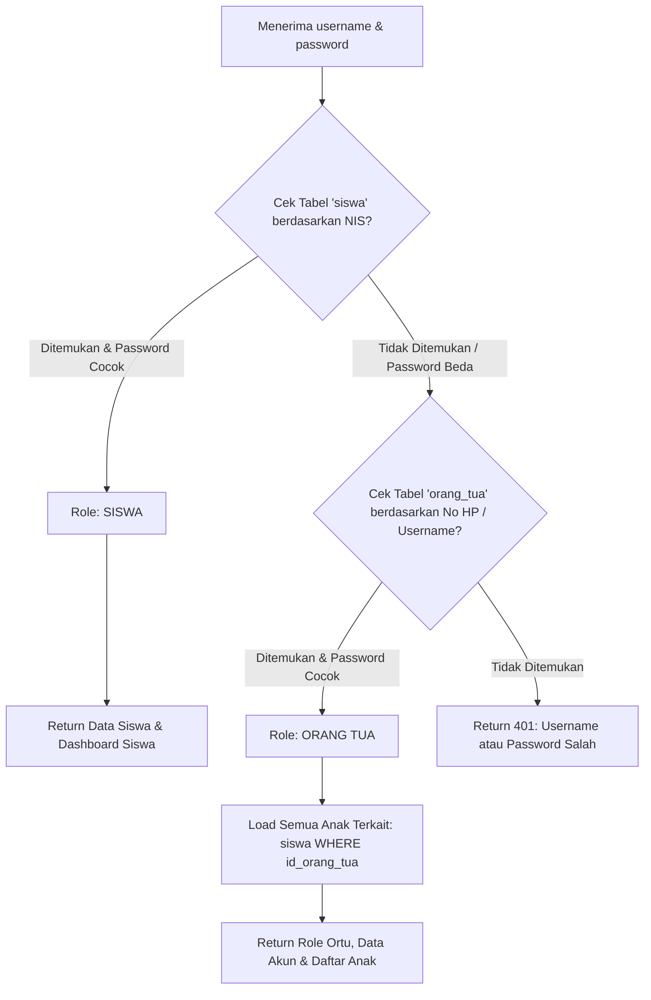

# Implementation Plan: Pemisahan Akun, Dashboard & Menu (Siswa vs Orang Tua) SIAWI

Dokumen rencana kerja teknis untuk memisahkan autentikasi akun, tampilan antarmuka (dashboard), serta diferensiasi menu antara **Siswa** dan **Orang Tua** pada ekosistem **SIAWI Mobile App** (`C:\laragon\www\siawi-app`) dan **SIAWI Admin/API** (`C:\laragon\www\siawi-admin`).

---

## 1. Analisis Kebutuhan Khusus Pengguna

Berdasarkan kebutuhan riil di lapangan:
1. **Tidak Ada Toggle Role di Mobile App**: Form login di aplikasi mobile tetap bersih dan simpel (hanya 2 input: **Username/Identifier** dan **Password**). Sistem backend yang secara cerdas mendeteksi otomatis apakah yang sedang login adalah **Siswa** atau **Orang Tua**.
2. **Kasus 1 Orang Tua Memiliki Lebih dari 1 Anak (Kakak-Beradik di Sekolah)**:
   - Jika menggunakan satu akun per siswa, orang tua terpaksa memiliki 2 akun terpisah dan harus bolak-balik login-logout menggunakan NIS yang berbeda.
   - **Keputusan**: **WAJIB OPSI 2 (Tabel Akun Orang Tua Terpisah)**. Satu akun orang tua dapat menaungi 2 anak atau lebih (*multi-child relation*), dengan fitur *Child Switcher* langsung di dashboard aplikasi.

---

## 2. Arsitektur Database: Opsi 2 (Tabel Akun Orang Tua Terpisah)

### A. Skema Database

#### 1. Tabel Baru: `orang_tua`
Menyimpan akun kredensial mandiri untuk Orang Tua/Wali:
```sql
CREATE TABLE orang_tua (
    id_orang_tua BIGINT UNSIGNED AUTO_INCREMENT PRIMARY KEY,
    username VARCHAR(100) UNIQUE,          -- Nomor WhatsApp / No. HP orang tua (contoh: 08123456789)
    password VARCHAR(255),                 -- Password orang tua (Hash bcrypt atau default)
    nama_lengkap VARCHAR(255),             -- Nama Orang Tua / Wali
    no_hp VARCHAR(30),                     -- Nomor WhatsApp untuk notifikasi
    alamat TEXT NULL,
    created_at TIMESTAMP NULL,
    updated_at TIMESTAMP NULL
);
```

#### 2. Relasi Anak ke Orang Tua: Kolom `id_orang_tua` pada Tabel `siswa`
Tambahkan relasi foreign key pada tabel `siswa`:
```sql
ALTER TABLE siswa ADD COLUMN id_orang_tua BIGINT UNSIGNED NULL AFTER id_siswa;
ALTER TABLE siswa ADD CONSTRAINT fk_siswa_orang_tua FOREIGN KEY (id_orang_tua) REFERENCES orang_tua(id_orang_tua) ON DELETE SET NULL;
```

---

## 3. Alur Autentikasi Backend Cerdas (Zero-Friction Single Form)

Aplikasi mobile mengirim request login sederhana tanpa perlu memilih peran:
```http
POST /api/login
Content-Type: application/json

{
  "username": "...",    // Bisa berupa NIS Siswa ATAU Nomor HP/Username Orang Tua
  "password": "..."
}
```

### Logika Pemeriksaan di Backend (`HomeController.php`):



---

### Response Payload API

#### 1. Jika Siswa yang Login:
```json
{
  "success": true,
  "role": "siswa",
  "data": {
    "id_siswa": 507,
    "nis": "253379",
    "nama_siswa": "Valentino Jonathan",
    "kelas": "XI-TJKT",
    "jurusan": "Teknik Jaringan Komputer"
  },
  "message": "Login Siswa Berhasil"
}
```

#### 2. Jika Orang Tua yang Login (Contoh: Menangani 2 Anak Sekaligus):
```json
{
  "success": true,
  "role": "orang_tua",
  "data": {
    "id_orang_tua": 12,
    "nama_orang_tua": "Bpk. Jonathan Lengkong",
    "username": "08123456789",
    "active_child_index": 0,
    "children": [
      {
        "id_siswa": 507,
        "nis": "253379",
        "nama_siswa": "Valentino Jonathan",
        "kelas": "XI-TJKT",
        "jurusan": "Teknik Jaringan Komputer"
      },
      {
        "id_siswa": 515,
        "nis": "264410",
        "nama_siswa": "Revalina Lengkong",
        "kelas": "X-KULINER",
        "jurusan": "Kuliner"
      }
    ]
  },
  "message": "Login Orang Tua Berhasil"
}
```

---

## 4. Perbedaan Dashboard & Menu di Mobile App (`siawi-app`)

### A. Tampilan Form Login (`login_view.dart`)
- **Tanpa Toggle**: Tampilan form tetap bersih dan intuitif:
  1. *NIS Siswa atau No. WhatsApp Orang Tua*
  2. *Kata Sandi*
- User menekan tombol **Masuk**.
- Mobile app secara otomatis membaca key `"role"` pada response JSON backend dan menyimpannya ke `SharedPreferences`:
  - `preferences.setString("userRole", json['role']);`
  - `preferences.setString("idSiswa", activeChildId);`
  - Jika orang tua, simpan daftar anak: `preferences.setString("childrenJson", ...);`

---

### B. Matriks Menu & Peran

| Menu / Fitur | Tampilan Siswa | Tampilan Orang Tua | Alasan Pemisahan |
| :--- | :---: | :---: | :--- |
| **Peralihan Anak (Child Switcher)** | Tidak Ada | **Ya (Dropdown Header)** | Orang tua dapat beralih pantauan antara anak ke-1 dan ke-2 |
| **Jadwal Pelajaran** | **Prioritas Utama** | Sekunder | Kebutuhan belajar harian siswa |
| **Modul & Materi Belajar** | **Ada** | **Tidak Ditampilkan** | Modul pembelajaran hanya untuk siswa |
| **Absensi & RFID** | Riwayat & Info Jam | **Monitoring Realtime** | Orang tua memantau jam masuk/pulang anak |
| **Tagihan & Keuangan (SPP)** | Disembunyikan / Ringkas | **Prioritas Utama** | Kewajiban administratif berada di pihak orang tua |
| **Poin Pelanggaran & SP** | Info Poin Pribadi | **Prioritas Utama** | Orang tua wajib memonitor pembinaan kedisiplinan anak |
| **Status PKL Industri** | Pengajuan Mandiri | **Monitoring Penempatan** | Orang tua memantau lokasi mitra dan kontak perusahaan |
| **E-Rapot & Prestasi** | **Ada** | **Ada** | Keduanya berhak memantau hasil belajar semesteran |

---

### C. Bottom Navigation Bar Dinamis

#### Bottom Bar Siswa:
1. `Profile` (Biodata & Akun Siswa)
2. `Jadwal` (Jadwal Pelajaran Lengkap)
3. `Home` (Dashboard Belajar Hari Ini)
4. `Modul` (Download/Akses Modul Mapel)
5. `About` (Info Sekolah)

#### Bottom Bar Orang Tua:
1. `Profile` (Biodata Ortu & Data Anak Terpilih)
2. `Tagihan` (SPP & Keuangan Sekolah)
3. `Home` (Monitoring Kehadiran, PKL & Berita)
4. `Point` (Buku Catatan Tata Tertib / SP)
5. `About` (Kontak Sekolah & Pengaduan)

---

## 5. Rencana Tahapan Eksekusi (Roadmap)

### Fase 1: Database & Panel Admin (`siawi-admin`)
- [ ] Buat migration tabel `orang_tua` dan tambahkan `id_orang_tua` pada tabel `siswa`.
- [ ] Buat migration/seeder script untuk memigrasikan nomor HP orang tua yang sudah ada di tabel `siswa` ke tabel `orang_tua`.
- [ ] Pada panel admin web (`Data Siswa`):
  - Tambahkan form relasi orang tua (bisa pilih akun orang tua yang sudah ada jika memiliki saudara kandung, atau otomatis dibuatkan baru).
  - Fitur reset password akun orang tua oleh Tata Usaha/Admin.

### Fase 2: Endpoint API Multi-Role (`siawi-admin`)
- [ ] Perbarui method `HomeController@login` pada `routes/api.php`:
  - Deteksi input NIS (Siswa) vs No HP/Username (Orang Tua).
  - Return payload role dan relasi data anak.
- [ ] Tambahkan endpoint `POST /api/orang-tua/switch-child` (atau switch lokal di mobile) untuk memperbarui token FCM dan id siswa aktif.

### Fase 3: Aplikasi Mobile Flutter (`siawi-app`)
- [ ] **Login Flow**:
  - Pertahankan single form login.
  - Tangkap key `role` dari backend dan lakukan percabangan route/layout.
- [ ] **Dashboard Orang Tua**:
  - Tambahkan widget *Child Switcher* di header dashboard orang tua:
    ```
    [ Anak: Valentino Jonathan (XI-TJKT)  ▼ ]
    ```
  - Susun grid menu khusus orang tua (Tagihan, Monitoring Absen, Poin Tata Tertib, Status PKL, E-Rapot).
- [ ] **Dashboard Siswa**:
  - Susun grid menu khusus siswa (Jadwal Mapel, Modul Belajar, Presensi, Pengajuan PKL, E-Rapot).

### Fase 4: Pengujian & Quality Assurance (QA)
- [ ] Uji login siswa tunggal.
- [ ] Uji login orang tua dengan 1 anak.
- [ ] Uji login orang tua dengan 2 anak (verifikasi *Child Switcher* berjalan mulus tanpa logout).
- [ ] Verifikasi notifikasi push FCM diterima dengan benar sesuai peran.
